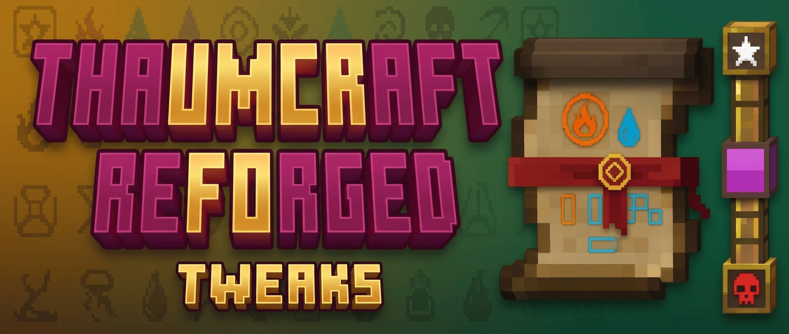

# Thaumcraft Reforged Tweaks

Client-side quality-of-life addon for [Thaumcraft 4 Reforged](https://github.com/notlikethiss/thaumcraft-4-reforged) on Minecraft 1.21.1 and NeoForge.

## Features

- Aspect browser: search by name (ru/en) or tag, combinations and sources.
- Arcane, crucible and infusion recipes, plus special applications.
- Native EMI integration (or EMI with JEI), recipe pinning and preview.
- Classic Thaumcraft NEI Plugin presentation in EMI: original book atlas, arcane grid, crucible and infusion diagrams; transparent ingredient slots.
- Witching Gadgets spinning wheel and infernal blast furnace recipes in EMI without JEI.
- Thaumic Energistics recipes are read automatically through the shared REFORGED registries.
- Thaumonomicon settings (`browserScale`): a rune button, a larger tree area, tab reordering with Ctrl+click, and background parallax without jerks.

## Requirements

- Minecraft 1.21.1, NeoForge 21.1.256, Java 21
- Thaumcraft 4 Reforged 1.1.2 or newer (required)
- [JEI](https://github.com/mezz/justenoughitems) 19.57.0.451 or newer and [EMI](https://github.com/emilyploszaj/emi) 1.1.24+1.21.1 (optional)

Versions used for the build:

- Mod 0.3.15
- ModDevGradle 2.0.148
- Parchment 2024.11.17

## Releases

Builds are published on the [Releases](https://github.com/evawevawevaw/thaumcraft-reforged-tweaks/releases) page. The mod version comes from `version` in `build.gradle`.

## Building

Thaumcraft 4 Reforged is not bundled. Download its jar from the [releases page](https://github.com/notlikethiss/thaumcraft-4-reforged/releases), put it into `libs/` as `thaumcraft-4-reforged-1.1.2-1.21.1.jar` and put `witching-gadgets-reforged-1.0-1.21.1.jar` into `libs/` for the optional integration compile classpath, then run:

    ./gradlew build     # build the mod jar into build/libs
    ./gradlew test      # run the regression tests

## Project layout

    src/main/java/dev/reforgedtweaks/
      client/         client lifecycle, resources and the research book
      integration/    EMI and JEI integration
    src/main/resources/   lang files, mixin configs and mod metadata
    src/test/             regression tests

## Credits

- [notlikethiss](https://github.com/notlikethiss) for [Thaumcraft 4 Reforged](https://github.com/notlikethiss/thaumcraft-4-reforged)
- [Glease](https://github.com/Glease) for [TC4Tweaks](https://github.com/Glease/TC4Tweaks), which served as the inspiration for this addon
- [emilyploszaj](https://github.com/emilyploszaj) for [EMI](https://github.com/emilyploszaj/emi)
- [mezz](https://github.com/mezz) for [Just Enough Items](https://github.com/mezz/justenoughitems)
- [EmanueleGiannuzzi](https://github.com/EmanueleGiannuzzi) for the textures and the idea, from [Thaumcraft-NEI-Plugin](https://github.com/EmanueleGiannuzzi/Thaumcraft-NEI-Plugin)

## License

[MIT](LICENSE)
